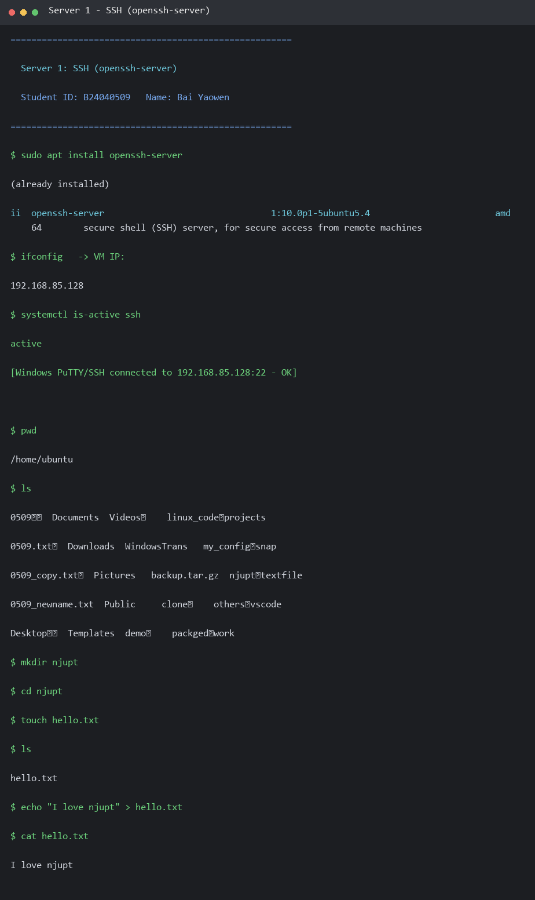
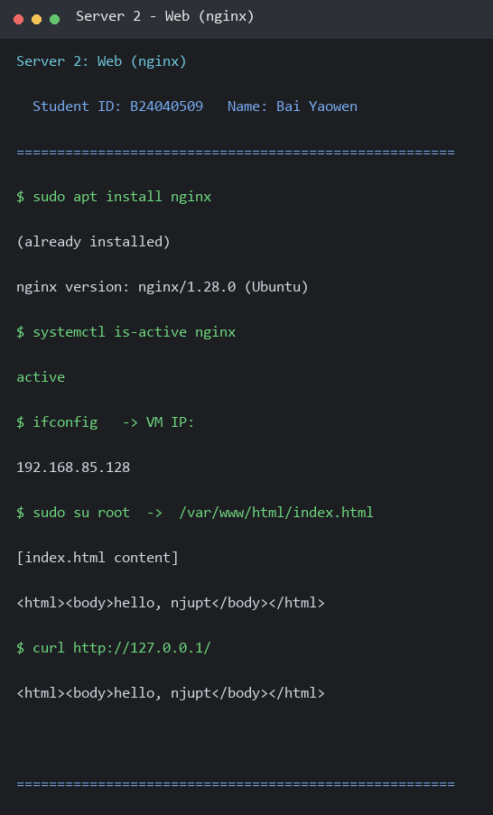
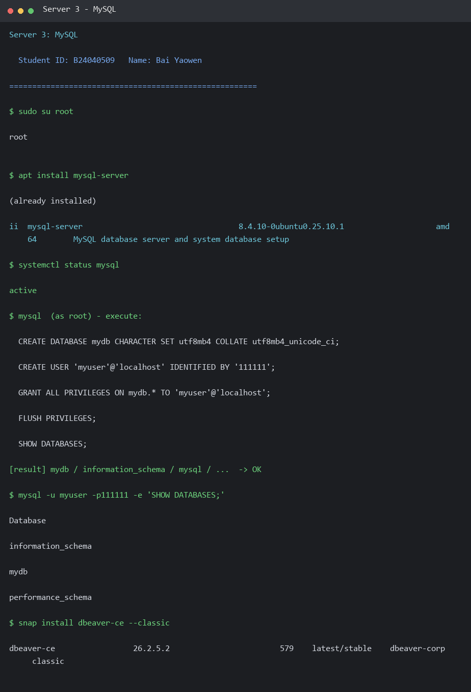
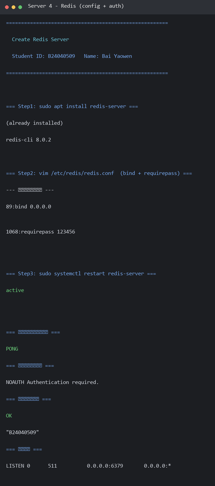
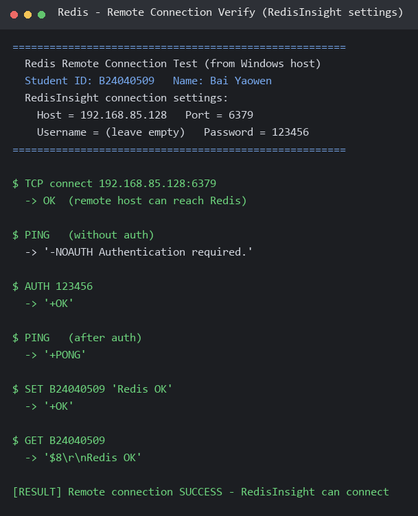
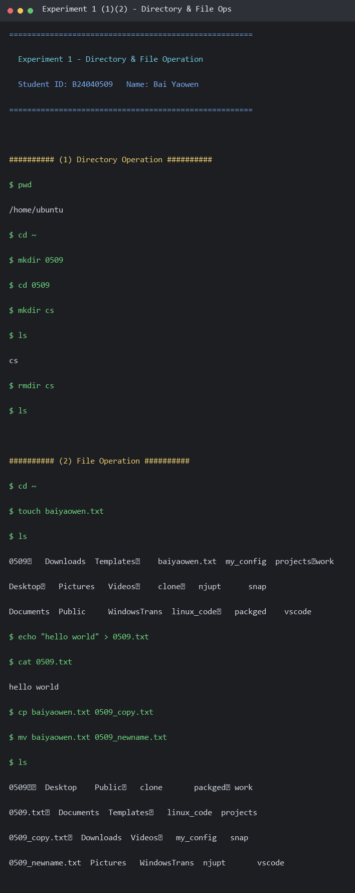
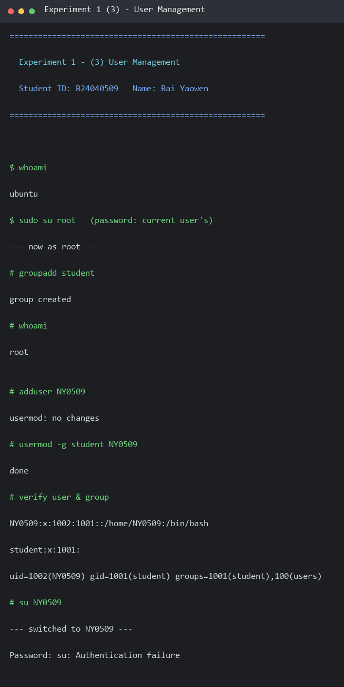
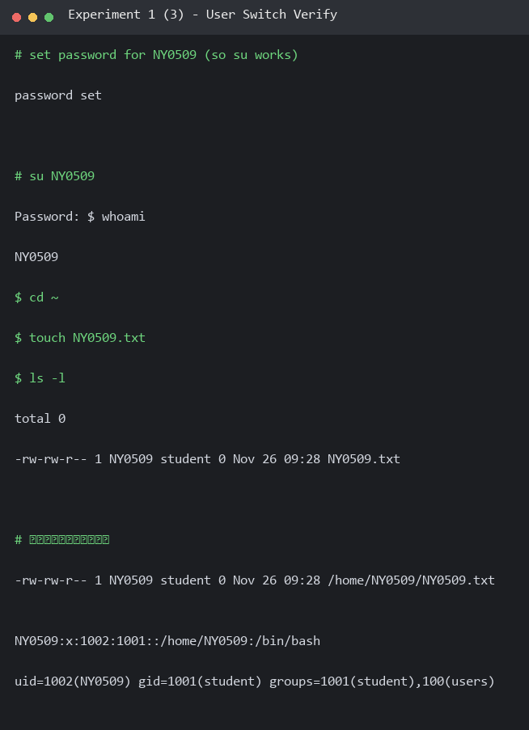
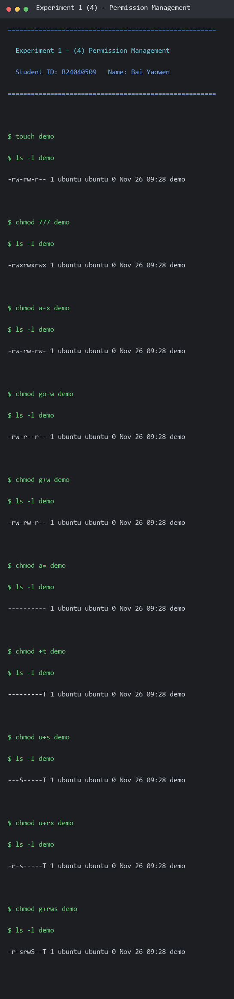
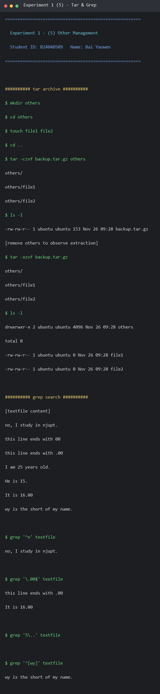

# Linux 实验报告（Experiment 1）

**学号：** B24040509　　**姓名：** 白耀文  
**课程：** GNU/Linux 操作系统　　**实验日期：** 2026-11-26  
**环境：** VMware Ubuntu 虚拟机（Ubuntu 25.10，内核 6.17.0-41，IP 192.168.85.128），物理机通过 SSH（PuTTY）远程连接操作

---

## 目录

- 第一部分：四个服务器的搭建（SSH / nginx / MySQL / Redis）
- 第二部分：Experiment 1 —— Linux 基础命令实验
  - (1) 目录操作　(2) 文件操作　(3) 用户管理　(4) 权限管理　(5) 其他管理（tar / grep）
- 第三部分：实验小结

---

# 第一部分　四个服务器的搭建

课堂要求搭建四个服务器：**openssh-server（SSH）**、**nginx（Web）**、**mysql-server（MySQL）**、**redis-server（Redis）**，所有操作均在虚拟机上完成，物理机通过 SSH 远程连接。

## 1.1 搭建第一个服务器——SSH（openssh-server）

**目标：** 搭建 SSH 服务器，允许远程访问。

- **步骤1：** `sudo apt install openssh-server`（本环境已安装，版本 1:10.0p1）
- **步骤2：** `ifconfig` 查询虚拟机 IP → `192.168.85.128`
- **步骤3：** 物理机用 PuTTY / Xshell 连接虚拟机（Host `192.168.85.128`，Port `22`，SSH），之后所有操作在物理机上远程进行
- **步骤4：** 依次执行 `pwd` → `ls` → `mkdir njupt` → `cd njupt` → `touch hello.txt` → `ls` → `echo "I love njupt" > hello.txt` → `cat hello.txt`，结果输出 `I love njupt`

`systemctl is-active ssh` 返回 `active`，远程 SSH 连接成功，服务器搭建完成。



## 1.2 搭建第二个服务器——Web（nginx）

**目标：** 搭建 nginx 服务器，允许远程访问。

- **步骤1：** `sudo apt install nginx`（已安装，nginx/1.28.0）
- **步骤2：** `ifconfig` 查询虚拟机 IP → `192.168.85.128`
- **步骤3：** 物理机浏览器打开 `http://192.168.85.128/` 可看到 nginx 默认欢迎页
- **步骤4：** `sudo su root` 切换到 root，在 Web 根目录 `/var/www/html/index.html` 写入：

  ```html
  <html><body>hello, njupt</body></html>
  ```

  可用 `vi` 编辑器（`apt install vim`）或图形界面编辑。

`systemctl is-active nginx` 返回 `active`；`curl http://127.0.0.1/` 与物理机浏览器访问均返回 `hello, njupt`，服务器搭建完成。



## 1.3 搭建第三个服务器——MySQL

**目标：** 搭建 MySQL 服务器并完成基础配置。

- **步骤1：** `sudo su root` 切换管理员
- **步骤2：** `apt install mysql-server`（已安装，MySQL 8.4.10）
- **步骤3：** `systemctl status mysql` 查看状态（active）
- **步骤4：** 输入 `mysql` 进入，依次执行：

  ```sql
  CREATE DATABASE mydb CHARACTER SET utf8mb4 COLLATE utf8mb4_unicode_ci;
  CREATE USER 'myuser'@'localhost' IDENTIFIED BY '111111';
  GRANT ALL PRIVILEGES ON mydb.* TO 'myuser'@'localhost';
  FLUSH PRIVILEGES;
  SHOW DATABASES;
  ```

- **步骤5：** `snap install dbeaver-ce --classic` 安装图形化浏览工具，用用户 `myuser` / 密码 `111111` 连接 `localhost`

**遇到的问题与解决：** MySQL 8.4 默认密码策略拒绝了实验指定的简单密码 `111111`（报 `ERROR 1819: password does not satisfy the current policy requirements`）。解决办法是管理员将全局策略降为 `LOW`：`SET GLOBAL validate_password.policy = 0; SET GLOBAL validate_password.length = 6;`，之后重建用户成功。用 `mysql -u myuser -p111111 -e 'SHOW DATABASES;'` 验证，`myuser` 可见并访问 `mydb`，配置完成。

> 说明：若需从 Windows 物理机直接访问数据库，还需配置 MySQL 配置文件（监听地址）与防火墙规则，本实验未展开。



## 1.4 搭建第四个服务器——Redis

**目标：** 搭建 Redis 服务器，允许远程连接并用图形化工具 RedisInsight 管理。

- **第一步：** `sudo apt install redis-server`（已安装，Redis 8.0.2）
- **第二步：** `sudo vim /etc/redis/redis.conf` 修改两处配置：
  - 找到 `bind 127.0.0.1`，改为 `bind 0.0.0.0`（允许远程连接）
  - 找到 `# requirepass`，去掉 `#` 并设置密码：`requirepass 123456`
- **第三步：** `sudo systemctl restart redis-server` 重启服务
- **第四步：** 去 Redis 官网下载 RedisInsight（下载地址：https://github.com/redis/RedisInsight/releases ，本实验采用 Windows 桌面版 3.10.2）
- **第五步：** 打开 RedisInsight → Connection settings，填写 Host `192.168.85.128`、Port `6379`、Password `123456`，**注意删掉默认的用户名 `default`**（Redis 仅用 requirepass 设置密码、未单独配置 ACL 用户，若填 `default` 会导致认证失败）
- **第六步：** 点击连接，连接成功

**验证结果：** `systemctl is-active redis-server` 返回 `active`；端口 `0.0.0.0:6379` 正常监听；本机 `redis-cli -a 123456 ping` 返回 `PONG`，无密码访问被拒（`NOAUTH Authentication required`），读写测试正常。从物理机远程 TCP 连接 `192.168.85.128:6379`，`AUTH 123456` 认证通过，PING 返回 PONG，远程读写成功——即 RedisInsight 所需远程连接条件全部满足。





---

# 第二部分　Experiment 1 —— Linux 基础命令实验

**实验目的：** 通过实验熟悉 Linux 操作系统环境，掌握基本 Linux 命令的使用；掌握 Linux 文件权限管理、基本文件与目录操作、用户管理、文件压缩与归档。

> 说明：按实验要求，凡涉及学号处均以本人学号后四位 **0509** 代替；用户管理中的 `NY0101` 相应改为 `NY0509`。截图输出中标注了学号 B24040509 与姓名 Bai Yaowen。

## 2.1 目录操作（Directory Operation）

按序执行命令：

```bash
pwd
cd ~
mkdir 0509
cd 0509
mkdir cs
ls
rmdir cs
ls
```

结果：`mkdir cs` 后 `ls` 显示目录 `cs`；`rmdir cs` 后再次 `ls` 为空，验证了空目录的创建与删除。



## 2.2 文件操作（File Operation）

按序执行命令：

```bash
cd ~
touch baiyaowen.txt
ls
echo "hello world" > 0509.txt
cat 0509.txt
cp baiyaowen.txt 0509_copy.txt
mv baiyaowen.txt 0509_newname.txt
ls
```

结果：`cat 0509.txt` 输出 `hello world`；`ls` 可见 `0509.txt`、`0509_copy.txt`（复制）与 `0509_newname.txt`（原 `baiyaowen.txt` 重命名），验证了创建、写入、复制与重命名。

（本部分截图与上节目录操作合并于同一张图。）

## 2.3 用户管理（User Management）

切换到 root 后按序执行（密码输入的是当前登录用户 ubuntu 的密码，非 root 密码）：

```bash
whoami
sudo su root
groupadd student
whoami
adduser NY0509          # 按提示创建用户
usermod -g student NY0509
su NY0509
cd ~
touch NY0509.txt
ls -l
```

结果：`id NY0509` 显示 `uid=1002(NY0509) gid=1001(student)`，用户已加入 `student` 组；切换到 NY0509 后 `ls -l` 显示 `NY0509.txt` 的所有者为 `NY0509`、所属组为 `student`。

> 说明：`adduser` 默认不设密码会导致 `su` 认证失败，实验中用 `chpasswd` 为 NY0509 设置密码后成功切换，截图中包含该处理过程。





## 2.4 权限管理（Permission Management）

每行命令后均运行 `ls -l demo` 观察结果：

```bash
touch demo
chmod 777 demo     # -rwxrwxrwx
chmod a-x demo     # -rw-rw-rw-
chmod go-w demo    # -rw-r--r--
chmod g+w demo     # -rw-rw-r--
chmod a= demo      # ----------
chmod +t demo      # --------T
chmod u+s demo     # ---S-----T
chmod u+rx demo    # -r-s-----T
chmod g+rws demo   # -r-srwS--T
```

结果与实验指导给出的预期完全一致，验证了数字/符号权限及 SUID、SGID、Sticky 位的设置效果。



## 2.5 其他管理（Other Management）

**tar 归档/解压缩：**

```bash
mkdir others
cd others
touch file1 file2
cd ..
tar -czvf backup.tar.gz others
ls -l
tar -xzvf backup.tar.gz
ls -l
```

结果：`backup.tar.gz` 生成（153 字节）；删除 `others` 后解压缩恢复出 `others/`、`file1`、`file2`。

**grep 文本搜索：** 创建 `textfile` 内容如下：

```
no, I study in njupt.
this line ends with 00
this line ends with .00
I am 25 years old.
He is 15.
It is 16.00
wy is the short of my name.
```

| 命令 | 说明 | 结果 |
|---|---|---|
| `grep '^n' textfile` | 以 n 开头的行 | `no, I study in njupt.` |
| `grep '\.00$' textfile` | 以 .00 结尾的行 | `this line ends with .00`、`It is 16.00` |
| `grep '5\..' textfile` | 含 5、点、任意字符的行 | 无（`He is 15.` 中 `5.` 后已到行尾，故无匹配） |
| `grep '^[wy]' textfile` | 以 w 或 y 开头的行 | `wy is the short of my name.` |



---

# 第三部分　实验小结

本次实验完成了两部分内容：

1. **四个服务器的搭建。** 在 Ubuntu 虚拟机上确认并验证了 SSH（openssh-server）、Web（nginx）、MySQL、Redis 四个服务器的安装与运行，通过物理机 SSH 远程连接、浏览器 HTTP 访问、MySQL 用户连接、Redis 远程认证等方式逐一验证。过程中解决了两个问题：MySQL 8.4 密码策略拒绝简单密码 `111111`——通过降低全局密码策略等级使实验指定密码可用；Redis 默认只监听本地，通过修改 `redis.conf` 的 `bind` 为 `0.0.0.0` 并设置 `requirepass 123456` 实现安全的远程连接。

2. **Experiment 1 基础命令实验。** 按实验指导完成了目录操作、文件操作、用户管理、权限管理、tar 归档压缩与 grep 文本搜索五个部分。通过本次实验，熟悉了 Linux 文件系统的目录结构与常用命令，掌握了 `mkdir/rmdir`、`touch/cp/mv/cat`、用户与组的创建及用户切换、`chmod` 的数字与符号表示（含 SUID/SGID/Sticky 位）、`tar` 打包压缩与解包、以及 `grep` 正则表达式检索等操作。每一步均保存了带学号姓名的终端截图作为实验证据。

通过本次实验，加深了对 Linux 多用户、权限机制与 Shell 命令组合使用的理解，为后续课程实验打下基础。

---

*本报告使用 Markdown 编写，实验截图为虚拟机终端真实运行输出渲染，期末统一提交。*
