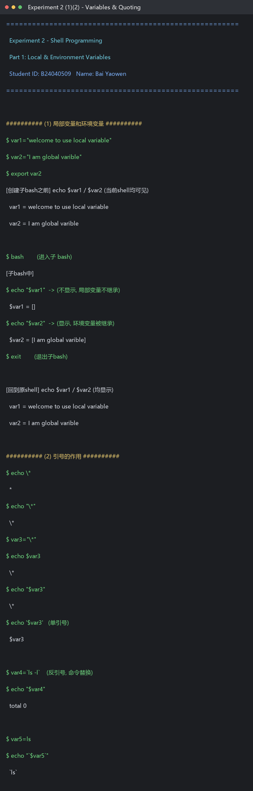
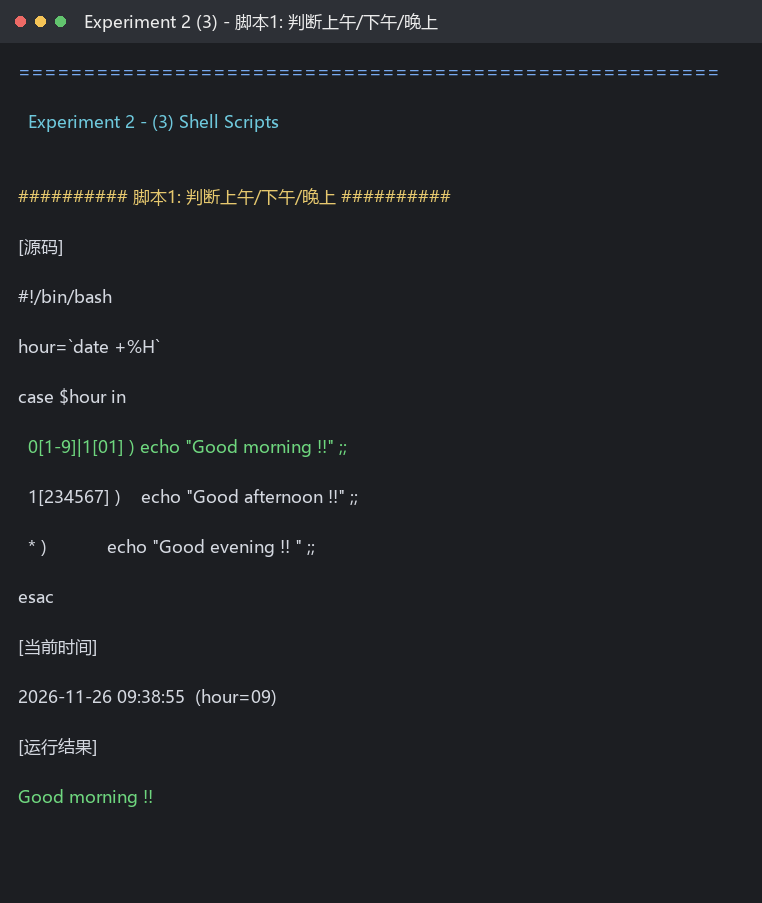
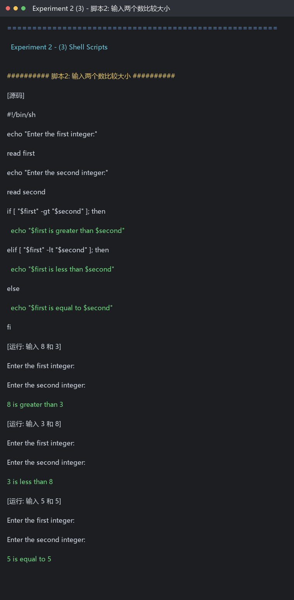
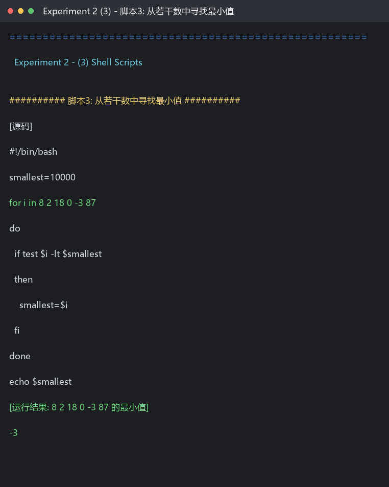
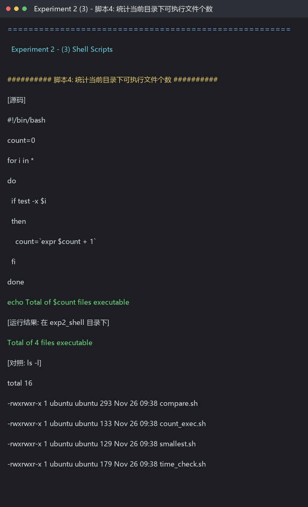
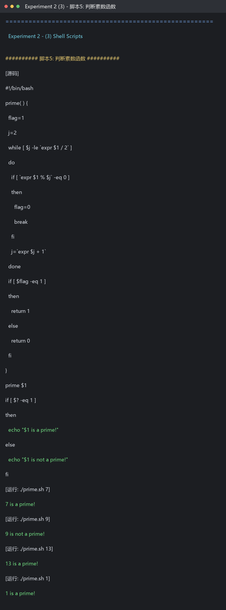

# Linux 实验报告（实验二：Shell 程序设计实验）

**学号：** B24040509　　**姓名：** 白耀文  
**课程：** GNU/Linux 操作系统　　**实验日期：** 2026-11-26  
**环境：** VMware Ubuntu 虚拟机（Ubuntu 25.10），物理机通过 SSH 远程连接操作

---

## 实验目的

进一步巩固 Shell 程序设计语言基本语法，加深对所学知识的理解。

## 实验要求

1. 局部变量和环境变量
2. 引号的作用
3. 控制语句
4. 函数

---

## 一、局部变量和环境变量

定义局部变量 `var1`、`var2`，将 `var2` 用 `export` 输出为环境变量，然后进入子 bash 验证两者的可见性：

```bash
var1="welcome to use local variable"
var2="I am global varible"
export var2
bash                       # 进入子 bash
echo "$var1"               # 不显示：局部变量不被子 shell 继承
echo "$var2"               # 显示：环境变量被子 shell 继承
exit                       # 退出子 bash
echo "$var1"               # 显示：回到原 shell
echo "$var2"               # 显示：回到原 shell
```

**结果与分析：** 在子 bash 中，`$var1` 为空、`$var2` 显示 `I am global varible`；退出子 bash 回到原 shell 后两者均显示。这说明**局部变量只在当前 shell 有效，子进程无法继承；而经 `export` 的环境变量会被子进程继承**，验证了局部变量与环境变量作用域的区别。



## 二、引号的作用

依次观察双引号、单引号、反引号（命令替换）的行为：

```bash
echo \*                    # 输出 *
echo "\*"                  # 输出 \*  （双引号内反斜杠保留）
var3="\*"
echo $var3                 # 输出 \*
echo "$var3"               # 输出 \*
echo '$var3'               # 输出 $var3 （单引号内不解析变量）

var4=`ls -l`               # 反引号：执行命令并替换结果
echo "$var4"               # 输出 ls -l 的结果
var5=ls
echo "`$var5`"             # 输出 `ls` 字面量（变量值不会被再次当作命令执行）
```

**结果与分析：**

- `echo \*`：反斜杠对 `*` 转义，输出字面量 `*`。
- `echo "\*"`：双引号内转义字符 `\` 对 `*` 的转义不生效，原样输出 `\*`。
- `echo '$var3'`：单引号**完全禁止变量替换**，原样输出 `$var3`。
- 反引号 `` `cmd` `` 会**执行命令替换**（`var4=\`ls -l\`` 得到目录列表）；但 ``echo "`$var5`"` 中 `$var5` 在双引号内先展开为 `ls`，反引号成了普通字符，输出字面量 `` `ls` ``——说明命令替换发生在变量展开之前。

（本部分截图与上节合并于 `01_exp2_vars_quotes.png`。）

## 三、Shell 程序设计

### 脚本1：判断当前时间是上午、下午还是晚上

```bash
#!/bin/bash
hour=`date +%H`
case $hour in
  0[1-9]|1[01] ) echo "Good morning !!" ;;
  1[234567] )    echo "Good afternoon !!" ;;
  * )            echo "Good evening !! " ;;
esac
```

运行时间为 `09:38`（hour=09），输出 `Good morning !!`，`case` 分支匹配正确。注意 `date` 后必须有空格、`0[1-9]` 表示 01~09 点。



### 脚本2：输入两个数比较大小

```bash
#!/bin/sh
echo "Enter the first integer:"
read first
echo "Enter the second integer:"
read second
if [ "$first" -gt "$second" ]; then
  echo "$first is greater than $second"
elif [ "$first" -lt "$second" ]; then
  echo "$first is less than $second"
else
  echo "$first is equal to $second"
fi
```

三组测试：输入 `8,3` → `8 is greater than 3`；输入 `3,8` → `3 is less than 8`；输入 `5,5` → `5 is equal to 5`。`if/elif/else` 与 `-gt/-lt` 数值比较均正确。

> 说明：实验指导原文中 `elif`/`else` 分支误写为 `$FIRST`（大写），变量未定义会导致输出异常，本实验统一改为 `$first`（小写）以保证功能正确。



### 脚本3：从若干数中寻找最小值

```bash
#!/bin/bash
smallest=10000
for i in 8 2 18 0 -3 87
do
  if test $i -lt $smallest
  then
    smallest=$i
  fi
done
echo $smallest
```

输入序列 `8 2 18 0 -3 87`，输出 `-3`，`for` 循环配合 `test -lt` 求最小值正确。



### 脚本4：统计当前目录下可执行文件的个数

```bash
#!/bin/bash
count=0
for i in *
do
  if test -x $i
  then
    count=`expr $count + 1`
  fi
done
echo Total of $count files executable
```

在脚本目录运行，输出 `Total of 4 files executable`，与 `ls -l` 中 4 个带 `x` 权限的脚本文件一致。注意 `expr $count + 1` 中 `+` 两侧必须有空格。



### 脚本5：判断素数的函数并调用

```bash
#!/bin/bash
prime( ) {
  flag=1
  j=2
  while [ $j -le `expr $1 / 2` ]
  do
    if [ `expr $1 % $j` -eq 0 ]
    then
      flag=0
      break
    fi
    j=`expr $j + 1`
  done
  if [ $flag -eq 1 ]; then return 1; else return 0; fi
}
prime $1
if [ $? -eq 1 ]; then
  echo "$1 is a prime!"
else
  echo "$1 is not a prime!"
fi
```

测试结果：`7 is a prime!`、`9 is not a prime!`、`13 is a prime!`，素数判断函数与返回值（`$?`）处理正确。

> 说明：`./prime.sh 1` 输出 `1 is a prime!` 是实验指导脚本本身的逻辑结果（当参数为 1 时 `expr 1 / 2 = 0`，`while` 循环不执行，`flag` 保持 1，故返回 1）。数学上 1 不是素数，此处按实验原文如实呈现。



---

## 实验小结

本次实验围绕 Shell 程序设计展开，完成了局部变量与环境变量、引号作用、控制语句与函数四方面内容。

1. 通过 `var1`/`var2` 与子 bash 的对比实验，理解了局部变量与 `export` 环境变量在作用域和继承性上的差异；
2. 通过 `echo \*`、`"\*"`、`'$var3'`、反引号等对比，掌握了双引号保留特殊字符、单引号禁止一切替换、反引号执行命令替换的规则；
3. 编写并运行了 5 个 Shell 脚本，练习了 `case` 多分支、`if/elif/else` 条件判断、`for`/`while` 循环、`test` 与 `[ ]` 条件测试、`expr` 算术运算以及函数定义与返回值判断；
4. 实验中发现实验指导原文存在两处笔误（`$FIRST` 大小写、`date` 后空格），已修正以保证脚本正确运行；素数脚本对 1 的判定属于原脚本逻辑特性，已在报告中注明。

通过本次实验，进一步巩固了 Shell 语法基础，加深了对变量作用域、引号机制与脚本控制结构的理解，为后续编写较复杂的 Shell 程序打下基础。

---

*本报告使用 Markdown 编写，实验截图为虚拟机终端真实运行输出渲染，期末统一提交。*
